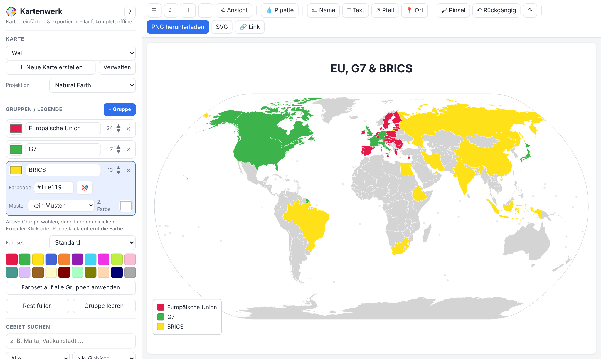

# 🌍 Kartenwerk

**Karten einfärben, beschriften und als Bild exportieren – direkt im Browser und komplett offline.**

Kartenwerk ist ein Werkzeug, um Länder und Regionen nach eigenen Gruppen einzufärben – für Schule, Studium, Präsentationen, Geschichte oder einfach aus Spaß. Alles läuft lokal im Browser: keine Anmeldung, kein Server, keine Datenübertragung.

## Funktionen

**Karten**
- Welt (5 Projektionen inkl. Globus) und alle Kontinente einzeln
- Deutschland (Bundesländer und alle 400 Landkreise), Türkei (81 Provinzen), USA (Bundesstaaten)
- Meere, Seen & Flüsse
- Eigene Karten: aus beliebigen Ländern zusammenstellen, Regionen von über 200 Ländern oder eigene GeoJSON/TopoJSON-Dateien

**Färben**
- Gruppen mit Farbe, Name und Legende – per Klick, Pinsel oder Suchliste
- Farbsets (u. a. farbenblind-freundlich und Abstufungen), Farbcodes, Pipette und Muster/Schraffuren
- Vorlagen für Bündnisse (EU, NATO, G7, BRICS …) und historische Reiche (Römisches, Osmanisches, Mongolisches Reich …)
- Filter nach Kontinent, Färbung, Vorlage oder Bundesland
- Nicht oder nur teilweise anerkannte Staaten mit Infos zum Status

**Gestalten**
- Titel, verschiebbare Legende, Namen von Ländern und Städten
- Eigene Texte, Pfeile und Orte auf der Karte
- Kartenstile (Standard, Vintage, Druck s/w, Nacht, Pastell) und Dunkelmodus

**Speichern & Teilen**
- Export als PNG (hohe Auflösung) oder SVG
- Konfiguration als Datei speichern/laden oder per Drag & Drop öffnen
- Teilen per Link – die ganze Karte steckt in der Adresse
- Rückgängig/Wiederholen, automatisches Speichern im Browser

## Nutzung

- **Online:** Die Seite über GitHub Pages öffnen.
- **Offline am PC:** `index.html` herunterladen und im Browser öffnen.
- **Als App auf dem Handy:** Die Seite einmal im Browser öffnen und „Zum Home-Bildschirm“ wählen – danach startet Kartenwerk wie eine App und funktioniert auch ohne Internet.

Deine Karten werden nur im Browser deines Geräts gespeichert. Für eine Sicherung „Konfiguration speichern“ nutzen.

## Tastenkürzel

| Taste | Funktion |
|---|---|
| `Strg` + `Z` / `Strg` + `Y` | Rückgängig / Wiederholen |
| `B` | Pinsel |
| `P` | Pipette |
| `T` / `A` / `O` | Text / Pfeil / Ort setzen |
| `N` | Namen einzeln ein-/ausblenden |
| `S` | Seitenleiste ein-/ausblenden |
| `Esc` | Werkzeug beenden |

## Quellen & Lizenzen

Die Karte nutzt freie Geodaten (u. a. Natural Earth und © GeoBasis-DE / BKG) sowie die Bibliotheken D3 und topojson-client. Alle Quellen und Lizenzen stehen in [QUELLEN.md](QUELLEN.md).

---

Mit ❤ gemacht von Kerem.
